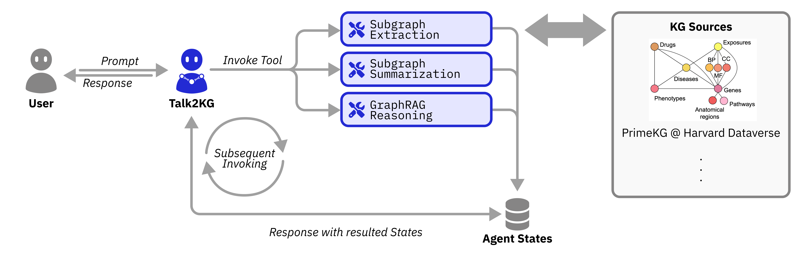

# Synapta

> Specialist Agent of **Phronesis**  
> **Made by ChronoStrider Engineering (ChronoStrider Enginnerings)**

**Synapta** is a specialist agent in the **Phronesis** ecosystem designed to enable interaction with biological knowledge graphs (KGs). KGs integrate vast amounts of structured biomedical data into a format that highlights relationships between entities, such as proteins, genes, diseases, drugs, etc.



> **Full PrimeKG, locally.** Besides the embedding-indexed IBD subset used by `subgraph_extraction`, Synapta can
> query the complete PrimeKG graph (129,375 nodes, 4,050,249 edges) in memory, with no Milvus or Docker. It
> provides drug / disease / gene profiles, mechanism paths, calibrated network-proximity repurposing,
> phenotype-ranked differential diagnosis, polypharmacy checks and gene-set enrichment. Build it once with
> `uv run phronesis-primekg build`; see [Full PrimeKG Analytics](primekg_full_graph.md).

## Tutorials
We have provided a series of tutorial in the forms of jupyter notebooks to help you get started with the library. The tutorials are available in the `docs/notebooks/synapta` directory.

For instance, we included a series of Jupyter notebooks to demonstrate the steps necessary to load PrimeKG and to construct IBD subgraph from PrimeKG.

### PrimeKG Loading
Precision Medicine Knowledge Graph (PrimeKG) is a comprehensive knowledge graph that presents a holistic view of diseases. PrimeKG integrates 20 high-quality biomedical resources to describe 17,080 diseases with 4,050,249 relationships representing ten major biological scales.

Source: [https://github.com/mims-harvard/PrimeKG](https://github.com/mims-harvard/PrimeKG)

The tutorial notebook to load the PrimeKG can be found in the following path:
```
docs\notebooks\synapta\tutorial_primekg_loader.ipynb
```

### IBD-sliced subgraph from PrimeKG
We have provided an example of working Jupyter notebook to construct a subgraph from PrimeKG in relation to a specific disease, i.e., inflammatory bowel disease (IBD).

The tutorial notebook to construct the subgraph can be found in the following path:
```
docs\notebooks\synapta\tutorial_primekg_subgraph.ipynb
```
