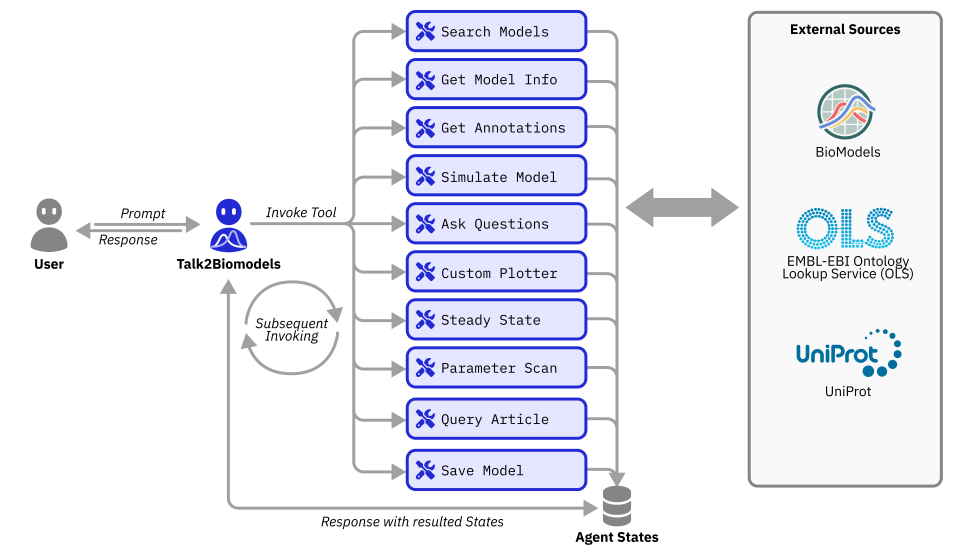

# Vivarix

> Specialist Agent of **Phronesis**  
> **Made by ChronoStrider Engineering (ChronoStrider Enginnerings)**

**Vivarix** is a specialist agent in the **Phronesis** ecosystem designed to interact with mathematical models in systems biology. You can choose to either interact with a model available in the BioModels database or upload your own model.

### What can Vivarix do?
✅ Interact with biological ODE models using natural language - just follow a simple prompt syntax  
✅ Upload or fetch SBML models directly from BioModels database  
✅ Run forward simulations  
✅ Visualize and explore simulation results through interactive plots and Q&A  
✅ Perform model analyses like steady-state and parameter scans  
✅ Understand species roles via readable annotations and functional insights  
✅ Get assistance with article comprehension using text-based retrieval (RAG)  

Please refer here for [FAQs](https://atlasrox.github.io/Phronesis/vivarix/faq/) and real-life [use cases](https://atlasrox.github.io/Phronesis/vivarix/cases/Case_1/).

### How to access Vivarix?

There are 2 ways to access Vivarix:

- **Set up the Streamlit app**: Follow the instructions on the home page to set up an launch the Streamlit app.
- **Use the PyPI package**: Follow the tutorial for step-by-step guidance on how to use the PyPI package.
